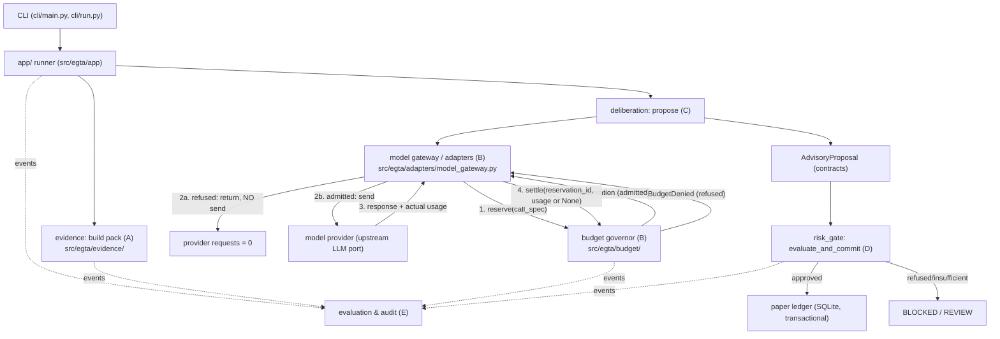

# Architecture Blueprint — Evidence-Governed TradingAgents (EGTA)

- **Status:** DRAFT — the **single D2 blueprint body** (B-owned). This is a draft;
  the concrete interfaces are governed by the approved contracts in `docs/req/` and
  the ADRs.
- **Source of truth for structure:** `execution_plan_261111.md` §4, §5, §8.1.
- **Related:** FR-02 (B), INV-03, NFR-01/02/04; ADR-001, ADR-003; invariants.

> This is the single D2 blueprint body. The repository-root `architecture-blueprint.md`
> is an entry link to this file (see `execution_plan` §8.1). Keep the two in sync.

## 1. The chosen shape: a modular monolith with contracts + adapters

The system keeps the upstream `tradingagents` / `cli` packages and adds five
single-responsibility modules under `src/egta/` plus three support components
(`contracts`, `app`, `adapters`). One implementation directory per rule; a rule is
never duplicated across modules. The rationale and rejected alternatives are in
**ADR-001** (`docs/architecture/adr/001-modular-extension.md`).

| Component | Owns | Must NOT own |
|---|---|---|
| `evidence` (A) | read allowed sources; emit immutable evidence pack | change risk config; fabricate publish time |
| `budget` (B) | reserve/settle quotas; admit/refuse external calls | produce the investment decision |
| `deliberation` (C) | propose/compare, cite evidence | execute; skip budget/risk gate |
| `risk_gate` (D) | sole risk authority; transactional paper ledger | call an LLM to waive a rule |
| `evaluation` (E) | subscribe to events; score; audit report | rewrite decisions or raw logs |
| `contracts` (B custodian) | shared schemas/types | business logic |
| `app` / `adapters` (B) | entry wiring; upstream/model ports | another module's private state |

## 2. Call graph: CLI → model entry → budget admission → evidence → audit

> **Target architecture — gateway not yet built.** The picture below is the intended
> wiring. The component that calls `reserve`/`settle` and the provider is the **model
> gateway** (B), not the governor. The governor only admits/refuses and tracks the
> hold; it does not send requests. PR #45 (governor) is in review; the gateway
> integration that actually drives these calls is still pending.

Key rule (INV-03): **every external model call passes through the budget governor
before it is sent.** The **gateway** calls `reserve`; on `BudgetDenied` it returns
without contacting the provider (zero provider requests); on `Reservation` it sends
the request, then calls `settle` with the actual usage (or `None` when unknown, which
keeps the hold). A gateway that bypasses the governor — tool binding, a
structured-output fallback, a retry — must not exist; those paths are the pending
verification items below.

## 3. Module boundaries and the contracts they share

- Shared types live in `src/egta/contracts/` (B custodian; producer+consumer approval).
  The evidence types `RunSpec / EvidenceItem / EvidencePack` are implemented and
  merged (PR #21); the shared `ReasonCode` lives in `egta.contracts.events`.
- Cross-module calls go through the frozen interface objects in
  `execution_plan_261111.md` §5.1 — e.g.
  `BudgetGovernor.reserve(call_spec) -> Reservation | BudgetDenied` and
  `BudgetGovernor.settle(reservation_id, actual_usage_or_unknown) -> BudgetState`.
- A module never reads another module's database, private class, or env var.

## 4. Budget governance (FR-02 / INV-03) — status

The budget governor is B's component:

- **Spec (frozen, merged):** PR **#22** (`test/offline/budget/`,
  `docs/req/trace-FR-02-budget-reservation.md`, `…-admission.md`). Four approved
  cases: unknown-usage holds the token reservation; an unsettled reservation stays
  held; known low usage releases unused tokens; two concurrent callers competing for
  the last call slot yield exactly one `Reservation` and one `BudgetDenied`.
- **Implementation (in review):** PR **#45** (`src/egta/budget/__init__.py`,
  `ledger.py`). SQLite, atomic reserve across tokens/cost/calls; unknown usage keeps
  the hold; partial settlement; idempotent re-settle; exact money comparison; one
  persisted limit set per database.
- **Still pending (not verified):** the **unified model gateway** wiring that makes
  the tested code drive admission itself — tool binding, structured-output fallback,
  zero-budget "0 requests reach transport", and sent-then-interrupted before usage.
  These are listed as acceptance items in `trace-FR-02-admission.md`; they are NOT
  claimed green here.

## 5. Evidence and determinism (FR-01 / INV-02)

Three things, at three different states:

- **Public types (merged):** `RunSpec` / `EvidenceItem` / `EvidencePack` in
  `src/egta/contracts/evidence.py` (PR #21) represent the pack outcomes with day
  precision. They carry data; they do not filter, mint ids, or compare digests.
- **Time policy (merged, A):** `src/egta/evidence/time_policy.py` (PR #4) applies
  the UTC date boundary. Per the committed contract (`docs/req/evidence-contracts.md`,
  from D's second #4 review at fixture `19da73a`):
  - **date-only** (`time_granularity="day"`) on the **same** UTC date as `as_of` is
    **excluded** (`availability="unavailable"`, `reason_code="FUTURE_DATA"`, never
    `INVALID_TIME`); it is admitted only when **strictly earlier** than the `as_of`
    UTC date;
  - **exact timestamp equality** (`published_at == as_of`, timezone-aware) is
    **admitted** — this is a different case from the same-date date-only exclusion.
- **Pack implementation (in review, A):** building the immutable pack, `evidence_id`
  generation from `run_id` + local id, dedupe, and pack-time `content_hash`
  recompute → `INTEGRITY_VIOLATION` are **PR #43, still open** — not merged.

The budget and risk components consume the pack; neither re-implements the filter.

## 6. Risk authority and the paper ledger (FR-04 / INV-01/04/06)

`risk_gate` (D) is the sole authority that may change the paper ledger. It re-reads
the portfolio version, checks the proposal hash/expiry, evaluates the rules, and
writes the verdict, ledger entries, and outbox audit event in ONE SQLite transaction
(INV-06). Duplicate proposals return the stored verdict (INV-04). See
`docs/architecture/adr/003-risk-authority.md`, `risk-policy.md`, `invariants.md`.

## 7. What is implemented vs pending (traceable)

| Area | Req IDs | Status | Where |
|---|---|---|---|
| Evidence public types (RunSpec/EvidenceItem/EvidencePack) | FR-01, INV-02 | **merged** | `src/egta/contracts/evidence.py` (PR #21) |
| Evidence time policy (UTC date boundary) | FR-01, INV-02 | merged (A) | `src/egta/evidence/time_policy.py` (PR #4) |
| Evidence pack build (ids/dedupe/pack hash) | FR-01, INV-02 | **in review** | PR #43 (open) |
| Risk gate + ledger (D) | FR-04, INV-01/04/06 | merged (D) | `src/egta/risk_gate/` |
| Budget **spec** | FR-02, INV-03 | **merged** | `test/offline/budget/` (#22) |
| Budget **governor** | FR-02, INV-03 | **in review** | `src/egta/budget/` (#45) |
| Unified model gateway wiring | FR-02, INV-03 | **pending** | `src/egta/adapters/` (not built) |
| Evaluation & audit (E) | FR-05, NFR-08/09 | merged (E) | `src/egta/evaluation/` |

## 8. Non-negotiables that wire across modules

- INV-03 — every external model call first obtains a budget reservation; if refused,
  no new inference is started.
- INV-01/06 — only an approved, same-transaction risk verdict changes the ledger.
- INV-02 — no data published after `as_of` is used.
- INV-07 — secrets never enter prompts, reports, commits, or session exports.

## 9. Open items for the next revision

- Build and prove the **unified model gateway** so no model call bypasses the governor
  (tool binding / structured fallback / retries / interruption). Until then, budget
  governance is proven at the governor layer, not end-to-end.
- Cross-process crash recovery of the budget ledger (reopen after a kill) is unverified.
- Align `RunSpec.limits` keys with the budget governor's `limits` once wired in `app`.
